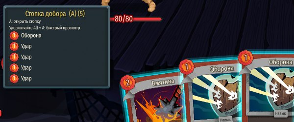
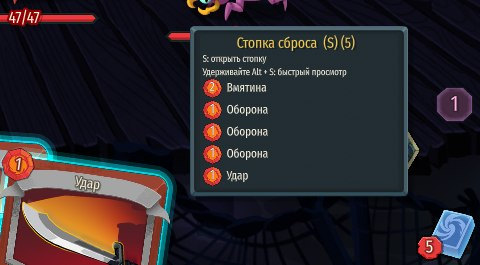
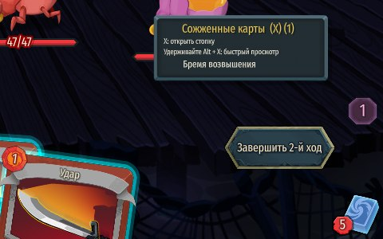

# Pile Peek

Hover the native draw, discard or exhaust button for a compact list of card names and current resource costs. Normal click/hotkey browsing stays native. Scroll over the pile button for large lists.

Hold Alt plus the game's current pile shortcut to show the quick list; release either key to close it. Default shortcuts: Alt+A draw, Alt+S discard, Alt+X exhaust. Unmodified shortcuts still open the native full viewer. The popup heading explains both actions using the current binding. Upgraded cards retain the native + suffix, green name and current modified cost.

The UI uses the game's hover-tip manager/frame, native card names, Kreon, energy textures and the actual card-scene star icon. Draw cards follow the native rarity/identity display sort; this is not the hidden draw sequence. Discard/exhaust retain native entry order. Duplicate card instances remain separate. X costs and non-energy costs follow the native card display; negative costs have no icon.

The player assembly has no developer-host dependency. An optional SDK adapter provides inspect and a bounded diagnostic preview-pile pose; a pose is not physical input verification. Original code is MIT-licensed; preserve the copyright and license notice when redistributing it. Developer: [Xaaalera](https://github.com/Xaaalera). Steam publishing profile: Infsection.

## Screenshots

| Draw | Discard | Exhaust |
| --- | --- | --- |
|  |  |  |

The gallery contains these close-ups and three wider gameplay captures from actual standalone0.1.0 testing. Images are mechanical crops/JPEG exports; no gameplay or UI was generated. Original captures are preserved privately. The complete assets/workshop/previews filename set is reconciled on publication; every release must retain useful demonstrations and verify the remote gallery.

## Install

Install compatible BaseLib/RitsuLib releases and enable them with Pile Peek in the game's mod configuration. For a manual build, create mods/PilePeek in your game directory and copy the Release PilePeek.dll, PilePeek.json and LICENSE into it. Restart the game after installation. [Workshop item](https://steamcommunity.com/sharedfiles/filedetails/?id=3822811887).

## Build

Set STS2_GAME_DIR to an installed0.107.1 game directory containing data_sts2_windows_x86_64. Requires .NET9.

```powershell
dotnet restore src/PilePeek.csproj --locked-mode
dotnet build src/PilePeek.csproj -c Release --no-restore
dotnet test tests/PilePeek.Tests.csproj -c Release
```

Runtime dependencies are BaseLib3.4.7 and RitsuLib0.6.7/API0.107.1. The player package contains only PilePeek.dll, PilePeek.json and LICENSE; native game assets/dependencies install separately. JSON catalogs are embedded from localization/ui. Godot.SourceGenerators4.5.1 is a build-only dependency for native C# input dispatch.

## Verification

Four isolated ordering tests pass in Release. Owned-game checks cover all three nonempty fixture piles, empty discard,47-card list, zero/X/star/negative costs and green upgraded Zap+ at0energy. Nine physical keyboard checks passed: all three held previews/releases, switching with old-key release, Alt-first release and ordinary A opening the native viewer. Physical mouse wheel advanced scroll0->90; pointer exit closed the list; clicks/Escape opened/closed native viewers for all three piles.

Actual client windows1280x720,1440x810,1600x900 and1920x1080 were visually inspected; the game retained its native1920x1080 logical viewport. All three lists were checked at the minimum window; the large list was checked at the other sizes. Native bounds contain the panels. Secondary shortcut help is small at720p. Mobile/web breakpoints are not applicable.

The exact extracted Release DLL passed a fresh native-only startup with only BaseLib/RitsuLib/PilePeek and an isolated profile. Physical standalone Ironclad/BowlbugsWeak combat checks showed hover, held Alt+A/S/X and release-close. After a real end turn, discard showed the five discarded cards, draw showed native empty text, and exhaust showed Ascenders Bane. That card was seeded into hand through the native console, then exhausted through the normal end-turn mechanism; no SDK fixture helper was loaded. Evidence/receipts stay in the workshop's ignored verification directory.

Steam delivery, multiplayer, alternate bindings/languages, repeated-key echo/focus-loss scenarios and other game/API lanes remain unverified. The initial source passed all five configured independent publication reviews.

## Development and publication

Run npm ci for the pinned review harness and pre-push hook. npm run review:info lists the required lenses; npm run review:attest -- <results.json> records actual independent results. The wrapper requires every enabled lens, its passing threshold, the exact reviewed HEAD and a reviewer identity; incomplete or stale results fail with REVIEW_RESULTS_INVALID (INVALID_ARGUMENT/400). Three Node regression tests cover this validation. Hosted review-gate scans the actual PR/main range for secrets; ordering-tests runs the four pure ordering tests without game binaries. Local runtime builds still need your installed0.107.1 references.

Changes merge into main through reviewed PRs. The private coordinator builds/tests merged green main and updates the existing Workshop item from its owned Steam runner. That workflow is maintained outside this public repository because it requires the private publishing machine. It uses only an allowlisted repository/item, preserves the accepted cover, and blocks ambiguous upload retries. A code/listing release requires a version bump in PilePeek.json and workshop.json. Use actual GitHub job results and the Workshop changelog to verify publication; CI configuration alone does not prove delivery.

Report issues at [the issue tracker](https://github.com/Xaaalera/sts2-pile-peek/issues) with versions, pile/card, language, window size and a screenshot/log excerpt.

The workspace research journal retains actual sources, implementation failures and verification limits. No third-party tracker source is copied; original prototype code is MIT-licensed.
